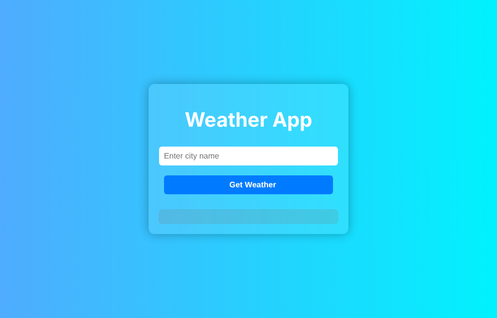

# Weather App

A small web app that shows the current weather for a city. It uses the OpenWeatherMap API.

## Features

- Search for a city by name
- Show temperature, humidity, and wind speed
- Show an error message if the request fails

## Tools

HTML, CSS, JavaScript, OpenWeatherMap API

## Setup

1. Clone the repository.
2. Get an API key from [OpenWeatherMap](https://openweathermap.org/api).
3. In `script.js`, replace `YOUR_ACTUAL_API_KEY` with your key.
4. Open `index.html` in a browser.

Do not commit your real API key to a public repository.
